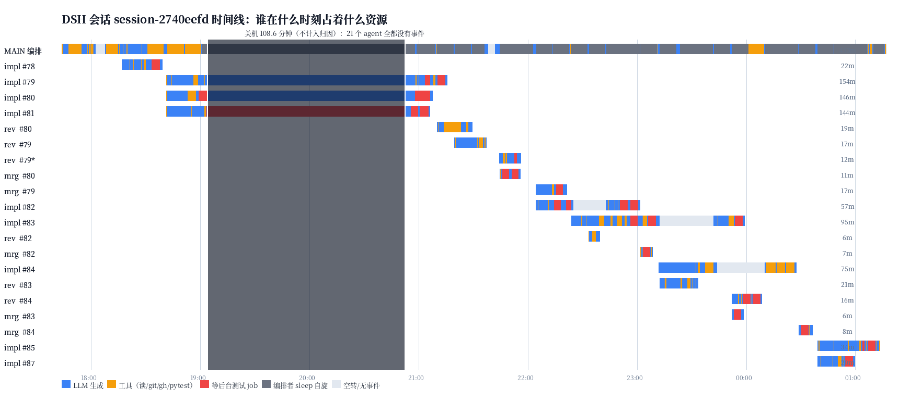

# 会话耗时报告：session-2740eefd（#77 收深八项）

对象：`/home/tofu/下载/dsh-session-session-2740eefd-ce11-4220-938e-fc3a60def62f.zip`
（1 个主会话 + 20 个下属会话，2026-10-08 17:43:43 → 2026-10-09 01:16:57）

一句话结论：**真正能归到「项目难维护」和「测试门禁臃肿」的加起来不到三分之一。**
最大的一块是编排者用 `sleep 540` 阻塞自旋等下属（占主 agent 有效时间 69%，
并在关键路径上白等 **34 分钟**），第二块是**步数**（1939 次 LLM 往返 × 均值 10.5 秒 = 338.9 分钟），
「项目难维护」和「门禁重复跑」只是后面的固定税。

> 挂钟 453 分钟里有 108.6 分钟是**你关机**（19:03:45 → 20:52:21，21 个会话全无事件）。
> 按要求这一项**不计入归因**；下面一律以**有效时间 344.6 分钟**为基数。



（图为每个 agent 一条：蓝=LLM 生成，橙=工具（读文件 / git / gh / pytest），红=等后台 job，
灰=编排者的 sleep 自旋，浅灰=空转无事件；深色竖带=关机，不计入。）

---

## 一、总账

| 项 | 数值 |
|---|---|
| 挂钟 | 453.2 分钟（7h33m） |
| 其中关机（无任何事件，**不计入归因**） | 108.6 分钟（19:03:45 → 20:52:21） |
| 其中人工重启空档 | 4.5 分钟（21:36:14 → 21:42:33，turn 23→25） |
| **有效时间（本报告全部归因的基数）** | **344.6 分钟（5h45m）** |
| agent 数 | 21（1 编排 + 9 实现 + 6 复核 + 5 合并） |
| agent 挂钟之和（扣关机） | 945 分钟 → 平均并发 2.7 |
| 下属并发度 | 1 个：79m ／ 2 个：138m ／ 3 个：175m ／ 4 个：7m（均值 2.28） |
| LLM 往返步数 | **1943 步**（其中 2 步是关机残留；延迟统计里剔除 → **1939 步**） |
| LLM 总时长 | **338.9 分钟**（中位 6.2s/步，均值 10.5s/步） |
| 上下文总量（每步重发之和） | **275.0M tokens**（97% 命中缓存），平均每步 142k |
| 产出 tokens | 1348k |
| LLM 调用并发 | 时间加权 **1.01**（峰值 4）——模型几乎从不是瓶颈 |
| 工具调用并发 | 1.37 |
| 交付 | 9 张票落地、41 个提交、`+5878 / −2492` 行 |

「上下文总量 275M」怎么来的：每一步都要把整段对话重发一遍。第 1 步约 10k tokens，
最后一步 170k–334k。**这笔是 token 账单，不是墙上时间**——上下文长度和单步延迟几乎无关（见三·2）。

---

## 二、每个 agent 的账

扣掉关机之后（`LLM` = step 减去该步工具占用；`工具` = call→result；`job` = 等后台 pytest）：

| agent | 角色 | 挂钟 | LLM | 工具 | 自旋 | pytest | 等 job | 步数 | 上下文中位 | 上下文峰值 |
|---|---|---|---|---|---|---|---|---|---|---|
| MAIN | 编排 | 344.6m | 48.2m | 285.4m | **229.0m** | 2.3m | 0.0m | 225 | 170,718 | 333,720 |
| 0838c7e1 | 实现 #83 | 94.9m | 37.6m | 27.2m | – | 14.1m | 12.6m | 151 | 194,254 | 282,904 |
| 1dd1ac43 | 实现 #84 | 75.2m | 28.5m | 20.2m | – | **20.0m** | 0.0m | 124 | 206,003 | 265,143 |
| eacac821 | 实现 #82 | 57.0m | 21.7m | 17.0m | – | 1.0m | 15.6m | 145 | 111,807 | 175,331 |
| bbe7650e | 实现 #79 | 45.5m | 32.8m | 12.6m | – | 4.8m | 7.4m | **254** | 224,313 | 322,118 |
| 83a6be83 | 实现 #80 | 37.4m | 19.8m | 17.6m | – | 4.8m | 12.7m | 78 | 209,039 | 253,897 |
| 7216d775 | 实现 #81 | 35.9m | 25.1m | 10.7m | – | 1.0m | 9.2m | 102 | 143,134 | 180,394 |
| 9409f3b3 | 实现 #85 | 34.1m | 26.8m | 7.2m | – | 1.6m | 5.2m | 205 | 174,487 | 232,419 |
| 2a3a1811 | 实现 #78 | 22.0m | 15.5m | 6.4m | – | 1.4m | 4.7m | 119 | 130,521 | 170,184 |
| fbf0b0fe | 复核 #83 | 21.0m | 16.7m | 4.3m | – | 3.9m | 0.0m | 73 | 63,873 | 109,168 |
| 47e11a61 | 实现 #87 | 20.4m | 13.3m | 7.2m | – | 2.7m | 4.3m | 92 | 132,905 | 182,713 |
| 34648cac | 复核 #80 | 19.3m | 8.8m | 10.5m | – | **9.9m** | 0.0m | 46 | 54,497 | 84,670 |
| 8e7c98d5 | 复核 #79 | 17.1m | 13.9m | 3.1m | – | 2.7m | 0.0m | 32 | 59,275 | 81,487 |
| 9632187c | 合并 #79 | 17.0m | 11.3m | 5.7m | – | 1.3m | 3.9m | 66 | 115,729 | 148,121 |
| 7f026dbc | 复核 #84 | 16.5m | 6.6m | 9.8m | – | 1.2m | 8.3m | 46 | 71,485 | 106,994 |
| 32107711 | 复核 #79（重试） | 11.7m | 8.8m | 2.9m | – | 1.5m | 1.2m | 64 | 82,073 | 122,678 |
| 1d939bc0 | 合并 #80 | 11.0m | 2.8m | 8.1m | – | 0.0m | 7.8m | 30 | 40,936 | 53,073 |
| 5dd2cb04 | 合并 #84 | 7.5m | 3.0m | 4.5m | – | 0.1m | 4.3m | 22 | 38,606 | 46,538 |
| d0d5de91 | 合并 #82 | 6.5m | 1.7m | 4.8m | – | 0.0m | 4.2m | 19 | 35,286 | 47,635 |
| 64609268 | 合并 #83 | 6.2m | 1.8m | 4.4m | – | 0.0m | 4.1m | 22 | 33,777 | 43,084 |
| 81fd27f9 | 复核 #82 | 5.8m | 3.6m | 2.2m | – | 2.0m | 0.0m | 28 | 57,461 | 76,293 |

> #79 与 #80 的 LLM 里各含约 4.8 分钟的关机残留（唤醒后看门狗延时），本表未扣除；
> 三·2 的延迟统计里已把这两步整条剔除。

按角色汇总：

| 角色 | 个数 | 有效挂钟合计 | LLM | 工具 | pytest | 等 job | 步数 | 上下文总量 |
|---|---|---|---|---|---|---|---|---|
| 编排 | 1 | 344.6m | 48.2m | 285.4m | 2.3m | 0.0m | 225 | 40.5M |
| 实现 | 9 | 422.5m | 221.1m | 126.0m | 51.4m | 71.8m | 1270 | 206.5M |
| 复核 | 6 | 91.3m | 58.4m | 32.8m | 21.4m | 9.5m | 289 | 18.3M |
| 合并 | 5 | 48.2m | 20.7m | 27.5m | 1.5m | 24.4m | 159 | 9.8M |

看这张表能直接读出三件事：

1. **实现者是 LLM 主导**（221m LLM vs 126m 工具），**复核/合并者是「等」主导**（工具与 job 等待超过 LLM）。
2. **编排者几乎不在干活**：344.6 分钟里 285 分钟在工具里，其中 229 分钟是 `sleep`。
3. 每张票的 3 个阶段里，合并者只花 6–17 分钟，复核者 6–21 分钟——**流水线两端的开销都不大，大头全在实现阶段和编排等待上**。

---

## 三、时间到底去哪了（按影响排序）

### 1. 编排者的 `sleep 540` 自旋：主 agent 69% 的时间，真正白等 34 分钟

主 agent 一共 **27 次阻塞式自旋等待**（22 次是整 9 分钟的 `sleep 540`，其余是等长轮询脚本），
扣掉关机仍有 **238 分钟**，占它有效时间（344.6 分钟）的 **69%**
（二·表里 MAIN 那行记的是 229 分钟，因为那张表只统计 `sleep` 开头的 26 次）。

代价不只是它自己的时间。**20 次下属交付里，16 次主 agent 当时正卡在自旋里**，平均要 **199 秒**才发现，
最长一次 **8.6 分钟**。这个数要分三层看，越往下越接近「真的浪费掉的墙上时间」：

| 口径 | 数值 |
|---|---|
| 逐次相加的反应延迟 | 66.2 分钟 |
| 按「一次睡醒」归并（同一觉里交付的多个下属只算一次） | **50.3 分钟** |
| 再扣掉窗口内**模型本来就在忙**的部分 | **33.7 分钟** |

最后那个才是真正白等的：13 段延误窗口里，全系统**一个 LLM 调用都没有在飞**的时间合计 33.7 分钟。
其余部分不算浪费，是因为那段时间别的 agent 正在用模型干活。而这 33.7 分钟是**串行**的——
下一张票、下一个复核都得等它醒过来才能派。

它是怎么来的？不是模型笨，是**规则逼出来的**：18:30 主 agent 自己写道「本轮目标有 40 个自动轮次上限，
现在到 18……上限会在完成之前用完」，随后 18:41 决定「用**阻塞式观察**代替空转轮次」。
也就是说，为了不烧轮次，它选择了 `sleep`。**「省轮次」换来了 34 分钟真正白等的墙上时间。**

另外，18:17→18:30 那 19 个 turn（83 步、12.2 分钟）是纯等 #78 的空转轮次（每轮只做一次 `list_agents`
+ 看一眼文件时间戳）。这一段是「轮次上限」逼出来的另一种形态。

### 2. 步数：1939 次 LLM 往返 × 均值 10.5 秒 = 338.9 分钟

这是「上下文」这个问题的**正确读法**：上下文长度几乎不影响单步延迟，它影响的是 token 账单。

- 单步延迟：中位 **6.2 秒**、均值 **10.5 秒**、最长 387 秒。
- **上下文长度与单步延迟基本无关**：r = 0.037。按上下文分桶的均值是
  3.5s（<20k）／9.8s（20–80k）／12.1s（80–150k）／10.4s（150–250k）／13.1s（>250k）——几乎是平的。
- 所以**时间来自步数本身**：1939 × 10.5s ≈ 339 分钟。**少一步就省 10 秒。**
- 尾部抖动确实存在，但不是上下文造成的：**20 步超过 60 秒，合计 54.0 分钟（占 LLM 时间 16%）**；
  7 步超过 120 秒（35.8 分钟）——这 7 步的上下文从 21k 到 165k 都有，属于 provider 侧抖动。

上下文的代价在**别处**——每个 agent 的上下文都是单调涨、从不回收（会话里没有任何压缩事件）：

| agent | 首步 | 末步 | 倍数 | 步数 |
|---|---|---|---|---|
| MAIN | 9,931 | 333,720 | 33.6× | 223 |
| 实现 #79 | 9,958 | 322,118 | 32.3× | 254 |
| 实现 #80 | 10,055 | 253,897 | 25.3× | 78 |
| 实现 #83 | 12,074 | 282,904 | 23.4× | 151 |
| 实现 #84 | 12,221 | 265,143 | 21.7× | 124 |

- 主 agent 峰值 **333.7k**，模型上限 384k——**离撞墙只差 13%**，撞上就是硬失败（这一步没发生，纯属运气）。
- 上下文总量 **275.0M tokens**（每步重发之和，97% 命中缓存）——这是**账单**，不是延迟。

### 3. 用 bash 当文件工具：1389 次 bash 里 890 次是 `cat/sed/head/tail`

| 工具 | 次数 |
|---|---|
| **bash** | **1389**（占所有工具调用 85%） |
| read | 312 |
| edit | 292 |
| grep | **2** |
| glob | **0** |

1389 次 bash 里，**890 次**（64%）是 `cat/sed -n/head/tail` 看文件，**458 次**（33%）是 `grep/rg` 搜内容。
典型形态是 `sed -n '1,160p' notes/brief.md`——这正是 `read` 工具干的事，但少了行号。

更关键的是**没有并行**：**84% 的步只带 1 个工具调用**（1939 步里只有 265 步 ≥2 个）。
一次读一个文件 = 一步 = 一次约 142k 上下文的完整重发——按上一条的口径，**这一步就是 10 秒**。
而系统提示里明明写着「Use the read tool — not shell commands like cat」「Use the glob tool — not shell find」
「Use the grep tool — not shell grep or rg」——**这条指令被违反了 1300 多次**。
把读文件批起来（一次发 4 个 `read`），是唯一能直接砍掉步数的杠杆。

### 4. 测试门禁：真实开销比看上去小，但有一次明显的重复

| 项 | 数值 |
|---|---|
| 用例总数（deepening77 分支） | **967 条**（collect-only 0.31s） |
| 单次全量 | **278–281 秒（约 4.6 分钟）** |
| pytest 调用次数 | **233 次** |
| ├ 指定文件的子集 | 178 次，48.3m（均 16.3s） |
| ├ 全量套件 | 22 次，14.0m |
| ├ collect-only | 14 次，4.9m |
| └ 看门狗脚本（循环里反复跑） | 3 次，24.9m |
| **单次 >150 秒的大跑** | **10 次，41.3 分钟**（其中 #84 的 4 次是真·全量 `pytest -q`，各 278–279 秒；#83 的 3 次是 3 文件子集，各 175 秒） |
| 后台跑的 pytest | 27 次 |
| 前台 pytest 合计 | **76.6 分钟** |
| `job_output` 等后台任务合计 | **105.7 分钟** |

门禁的真实成本 ≈ 前台 76.6m + 后台等待 105.7m ≈ **180 分钟**，但这是**并发**花掉的
（9 个实现者同时在跑），它并没有 1:1 加到 344.6 分钟的墙上。

**真正该改的是重复**：
- **实现 #84 一个 agent 跑了 4 次全量**（279+279+278+277 = 18.5 分钟），占它 75 分钟有效时间的 25%；
- 一张全套流水线的票要跑：实现者收工 1 次全量 + 复核者基线 1 次 + 复核者变异后 1 次 + 合并者 1 次 = **4 次全量 ≈ 19 分钟**；
- 复核 #80 的 9.9 分钟 pytest 几乎全是变异验证（先跑一遍基线，再把 `testing.py` 换回旧版重跑，
  确认新测试真的变红）——**这笔钱花得值**，它是唯一能证明「测试真的钉住了行为」的手段。

对比一下量级：**门禁 ~180 分钟是并行花的，编排自旋白等的 34 分钟是串行花的。**先修编排。

### 5. 返工：3 次复核驱动的补丁 + 1 次派活错误 + 1 次重启损失

| 事件 | 代价 |
|---|---|
| #82 复核抓到**阻断**（不是代码缺陷，是主 agent 派活时给了过期基线 `b426f3c`） | 实现者被叫回补基线 + 守卫，22:42→23:01，**18 分钟** |
| #83 复核后补守卫（内联比较守卫失去覆盖） | 23:42→23:58，**16 分钟** |
| #84 复核后补空断言 | 00:10→00:27，**17 分钟** |
| 21:36 人工重启，**丢掉正在跑的复核 agent 8e7c98d5** | 该 agent 已跑 17 分钟，重派 32107711 又 11.7 分钟 |
| #79 两次「分阶段提交」提醒（攒了 21 个文件没提交） | 提醒本身便宜，但风险是真实的 |

值得注意：这 3 次返工都是**复核者用变异验证量出来的**，不是挑刺——属于花得值的钱。
真正的浪费是那次**派活基线错误**：主 agent 在 22:42 自己承认「不是代码缺陷，是我派活时的基线错误」。

### 6. 定向成本：实现者开工到第一次改文件，中位 8.8 分钟

| 实现者 | 开工→第一次改文件 | 此前 read 次数 | 此前工具次数 |
|---|---|---|---|
| #83 | **20.2 分钟** | 36 | 66 |
| #81 | 13.4 分钟 | 14 | 45 |
| #84 | 12.2 分钟 | 22 | 36 |
| #85 | 11.2 分钟 | 47 | 63 |
| #80 | 8.8 分钟 | 37 | 60 |
| #79 | 7.5 分钟 | 50 | 63 |
| #78 | 4.2 分钟 | 26 | 39 |
| #82 | 3.9 分钟 | 15 | 32 |
| #87 | 1.9 分钟 | 15 | 24 |

#83 前 20 分钟一个文件都没落，主 agent 在 22:43 不得不发提醒「你的工作区到现在还一行没动」。
中位 8.8 分钟的定向时间，对一个 5h45m 的会话来说是 **15–20% 的固定税**。

---

## 四、那么，是「可维护性差」吗？

**不是主因，但有两个真问题。**

先看工作本身有多大——它不是「改几行」：

- 本次 41 个提交，`+5878 / −2492` 行，涉及 20–37 个文件/票（含测试与文档）；
- 仓库规模：`src/` **16,855 行**、`tests/` **23,231 行**、**967 条**用例；
- 改动面本身就是横切的：`storage/store.py`、`sync/engine.py`、`sync/view.py`、`sync/push.py`、
  `tui/app.py`、`tui/pages/detail.py`、`testing.py`、`vocabulary.py` 几乎每张票都要动。

所以 5h45m 做完 9 张横切重构票，**不能简单说「慢」**。真正的可维护性问题是两个可量化的：

**(1) 单文件偏大，AI 必须分段读。** 最大的几个文件：

| 文件 | 行数 |
|---|---|
| `src/dida/tui/app.py` | 1,373 |
| `src/dida/storage/store.py` | 1,223 |
| `src/dida/testing.py` | 1,133 |
| `src/dida/tui/pages/detail.py` | 1,126 |
| `tests/test_detail_page.py` | 1,653 |
| `tests/test_architecture.py` | 1,096 |

本次会话里 **`read` 被调用 312 次，覆盖 157 个不同文件**；同一文件被反复读：
`sync/engine.py` 11 次、`tui/app.py` 10 次、`testing.py` 9+8 次、`pages/detail.py` 7 次。
单文件超过 ~800 行之后，agent 只能 `sed -n '500,680p'` 这样切片，既费步数又拿不到全局。

**(2) 跨模块的横切改动，没有单一落点。** 一张「把共用词汇独立成模块」的票（#78）要改 12 个文件；
一张「写链收成一个家」的票（#83）要改 11 个入口。这不是代码坏，是**这些改动天生横切**——
但它们每一次都要 agent 重新把 20 个文件读一遍才能确认「谁还依赖谁」。

**结论**：可维护性贡献的是**定向时间**（中位 8.8 分钟/实现者）和**步数**（每张票 78–254 步），
它是「固定税」，不是「7.5 小时」的主因。把 `app.py` / `store.py` / `testing.py` / `detail.py` 拆到
500 行以下，能省的是这部分税，不是那 34 分钟。

---

## 五、那么，是「测试门禁臃肿」吗？

**也不是主因，但有一处该修的浪费。**

- 967 条用例、单次全量 4.6 分钟——对一个近 17k 行的项目，这个量级是**合理**的，不是臃肿。
- 门禁时间（~180 分钟）是**并行**花掉的，而编排自旋真正白等的 34 分钟是**串行**花掉的。
  即使把测试时间砍一半，墙上也只省下实现者那点并发时间；而砍掉自旋，34 分钟是直接省下来的。
- 变异验证（复核 #80 的 9.9 分钟、复核 #83/#84 的）**是这次会话里性价比最高的一笔支出**：
  它抓出了 3 个「守卫失去覆盖 / 空断言」的真问题，这些问题不靠变异根本看不出来。

该修的是**重复**，不是**总量**：

| 浪费 | 量 |
|---|---|
| 实现 #84 一票跑了 4 次全量 | 18.5 分钟 |
| 全套流水线一票 4 次全量（实现收工 + 复核基线 + 复核变异 + 合并后） | 每票约 19 分钟 |
| 3 次「看门狗脚本」里循环跑 pytest | 24.9 分钟 |
| 233 次调用里 178 次是子集 | 这个是对的，别动 |

---

## 六、建议（按性价比排序）

**立刻能做，省得最多：**

1. **别用 `sleep` 自旋等下属。** 结束轮次、让完成通知把主 agent 叫醒——省 **~34 分钟**关键路径
   （口径见三·1：那段时间全系统没有任何 LLM 调用在飞）。
2. **把目标轮次上限调大**（或不要用轮次上限约束长编排）。这次的 `sleep 540` 就是为了省轮次
   才发明的，属于规则倒逼出来的反模式。省轮次的代价是 34 分钟白等的墙上时间。

**下一步（这一档砍的是「步数」，性价比最高）：**

3. **一次发多个工具调用**（并行读 3–5 个文件）。84% 的步只带 1 个工具调用；
   按均值 10.5 秒/步算，**把每天几百次单文件读批成 1/4，就能省下 1–1.5 小时**。
   这是唯一能直接砍步数的杠杆。
4. **用 `read` / `glob` / `grep` 而不是 `cat` / `sed -n` / `grep`。** 890+458 次 shell 文件操作换成专用工具，
   顺带拿到行号（这次 agent 引用行号全靠自己数）。这一条要写进派活模板并加一条守卫式自检。
5. **全量套件每票只跑一次**（合并后），实现者收工跑受影响的子集 + 复核者跑变异验证。
   `#84` 那种一票 4 次全量是纯浪费，可省 ~15 分钟/票。
6. **给长会话加压缩**。峰值 333.7k / 上限 384k，没有任何回收机制。它省的是 token 账单
   （275M）和「撞上限硬失败」的风险，**不省延迟**——别把它当成提速手段。

**中期：**

7. **拆大文件**：`tui/app.py`（1373）、`storage/store.py`（1223）、`testing.py`（1133）、
   `tui/pages/detail.py`（1126）。目标是单文件 < 500 行，让 agent 一次 `read` 就能拿全——
   直接减的是三·6 那 8.8 分钟的定向税和切片读的步数。
8. **复核者模板里加一句**：变异验证只跑受影响的测试文件（现在有人跑了全量 9.9 分钟）。
9. **派活前用 `git rev-parse` 把基线写死在 prompt 里**（#82 那次阻断就是基线过期）。

---

## 七、哪些能靠提示词解决，能省多少

先立一条口径，否则会高估：**不是所有省下来的时间都等于墙上时间。**
实测模型全程只有 **65%** 的时间有调用在飞（**121.1 分钟**里全系统一个 LLM 调用都没有）。
所以「省掉的活」只有在**落在关键链上**、或**落在模型本来就空闲的窗口里**，才真的省墙上时间。
下面每一行都按这个口径算。

| # | 措施 | 提示词能解决吗 | 省下（墙上） | 依据（实测） |
|---|---|---|---|---|
| 1 | **别用 `sleep` 自旋等下属**，结束轮次等通知 | ✅ 能（行为规则） | **~34 分钟** | 13 段延误窗口合计 50.3 分钟，其中**模型真空闲 33.7 分钟**——那段时间全系统没有任何调用在飞，纯等 |
| 2 | **一次发 3–5 个 `read`/`grep`**（并行工具调用） | ✅ 能（行为规则） | **~40–60 分钟** | 795 个「纯看文件/搜内容」的步占全部步数 **41%**；按每步 3 个批量省 358 步 ≈ **74 分钟模型时间**，其中关键链上 **59.8 分钟** |
| 3 | **全量套件一票只跑一次**（收工前） | ✅ 能（预算规则） | **~14 分钟** | `#84` 连跑 4 次全量，后三次（00:11 / 00:16 / 00:22）期间模型在飞 **0 / 7 / 0 秒**——全系统陪它等 |
| 4 | **派活时把基线 commit 写死在 prompt 里** | ✅ 能（流程规则） | **~18 分钟** | `#82` 因过期基线返工 18.5 分钟；`#84` 是在 `#82` 合并后 **30 秒**被派出去的，所以这 18 分钟原样推迟了下游解锁 |
| 5 | **等下属时别每轮都去查** | ✅ 能（行为规则） | ~12 分钟模型时间（不一定全落在墙上） | 主 agent turn3–21 有 83 个步只调了 `list_agents` / 看时间戳，12.2 分钟，对结果零影响 |
| 6 | 复核者的变异验证只跑受影响文件 | ✅ 能（模板一句话） | ~1 分钟 | `rev #80` 第二次全量期间模型真空闲 47 秒 |
| — | 用 `read`/`glob`/`grep` 取代 `cat`/`sed -n`/`grep` | ⚠️ **半能** | 不直接省步数 | 这条**系统提示里已经写了**，仍被违反 1300+ 次；它省的是上下文体积与行号质量，省步数要靠第 2 条的批量 |
| — | 拆大文件（`app.py` 1373 行等） | ❌ 不是提示词，是代码工作 | 间接：定向税中位 8.8 分钟/人 | 拆到 <500 行后一次 `read` 拿全，直接减第 2 条的段数 |
| — | 给长会话加压缩 | ❌ 不是提示词，是 harness 功能 | **0**（省的是 275M token 账单与撞上限风险） | 上下文长度与单步延迟 r=0.037，压缩**不提速** |
| — | 把目标轮次上限调大 | ❌ 不是 AGENTS.md，是会话/目标设置 | 它是第 1 条的**根因** | 不解决它，`sleep` 会回来 |

**合计（1+2+3+4+5，保守取下界）：约 106–140 分钟 ≈ 1.8–2.3 小时，占有效时间 344.6 分钟的 31–40%。**

### 可以直接贴的提示词

`AGENTS.md` 会被注入**每一个** agent（含全部下属）的上下文——这一点我核对过会话文件：
子 agent 的 `user/message` 里确实带着整份 AGENTS.md。所以下面这段放 `AGENTS.md` 就能覆盖 21 个 agent；
第 1/4/5 条只跟编排者有关，放 `notes/brief.md` 也可以。

```markdown
## 编排纪律（四条，都有实测依据）

上一轮 7.5 小时 / 21 个 agent 的会话量过账（见 notes/session-cost-2026-10-08-deepening77.md），
下面四条各值十几到几十分钟。它们不是「更努力」，而是**改掉会白等的动作**。

1. **等下属时不要 `sleep` 自旋。** 结束这一轮，让完成通知把你叫醒。
   实测：用 `sleep 540` 等的时候，13 段延误窗口里全系统**一个 LLM 调用都没有在飞**，
   真空闲 33.7 分钟，纯等。（`sleep` 是为了绕开轮次上限发明的——正确做法是先把上限调大。）

2. **读文件一次发多个工具调用。** 用 `read` / `glob` / `grep`，并且**同一轮里发 3–5 个**，
   不要一个文件一步。实测：795 个「纯看文件」的步占全部步数的 41%；按每步 3 个批量能省 358 步
   ≈ 60 分钟。不要用 `cat` / `sed -n` / `grep` 看文件——它们一次只能看一个，还不带行号。

3. **全量套件一票只跑一次**（收工前那次）。中途改一行就跑全量是纯等：
   实测某票连跑 4 次全量（各 279 秒），后三次里全系统模型在飞时间是 **0 / 7 / 0 秒**。
   中途跑受影响的文件子集；复核者做变异验证时同样只跑受影响文件。

4. **派活时把基线 commit 写死在 prompt 里**（`git -C <worktree> rev-parse HEAD`）。
   实测有一次给了过期基线，复核抓到阻断，返工 18 分钟，并把下游那张票的解锁推迟了同样久。
   同时：**等下属时不要每轮都去 `list_agents` 看进度**——上一轮 83 个这样的步（12.2 分钟）
   对结果零影响。查一次，然后结束轮次。
```

---

## 八、口径与不确定度

- **step** = 一次 LLM 往返（`step/start` → `step/end`）；
  **LLM 时间** = step 时长 − 该步内工具占用（区间并集，容忍并行）；
  **工具时间** = `tool/call` → 同 `callId` 的 `tool/result`；**空转** = 不属于任何 step 的墙钟。
- `inputTokens` 是**未命中缓存**的部分，`totalTokens`（含 `cacheReadTokens`）才是整段上下文。
  本报告里「上下文」一律指 `totalTokens`。
- **关机 108.6 分钟**按要求不计入归因。它确实存在（全局空洞 19:03:45 → 20:52:21，
  主 agent 自己也在 20:58 说「时间跳了一大截（机器大概睡过一觉）」），本报告只用它把
  453.2 分钟换算成 344.6 分钟的有效基数。
- 受关机影响的两步（`bbe7650e` step170、`83a6be83` step66）在唤醒后各多挂了约 4.8 分钟的
  看门狗延时，这两步已从延迟统计里**整条剔除**（步数 1943 → 1939）。
- **上下文与延迟的关系**：r = 0.037，分桶均值 3.5／9.8／12.1／10.4／13.1 秒。
  早先一版报告里「>250k 上下文均值 47.9 秒」是**错的**——那个均值被上面那两步关机残留拉爆了，
  已在三·2 更正。这个更正很关键：它把「上下文太长导致慢」这个直觉证伪了，
  真正的杠杆是**步数**。
- **反应延迟**的口径：下属最后一个事件 → 主 agent 的下一个工具调用。逐次相加得 66.2 分钟，
  但按「一次睡醒」归并（同一觉里交付的多个下属只算一次）得 **50.3 分钟**；
  再扣掉窗口内模型本来就在忙的部分，**真正浪费掉的墙上时间是 33.7 分钟**。七·表里用的是最后这个数。
- **模型占用**：时间加权平均只有 **1.01 个调用在飞**（0 个在飞 121.1 分钟 / 1 个 116.7 / 2 个 87.4 /
  3 个 17.7 / 4 个 1.0）。这条是「哪些能靠提示词省时间」那一节的判据——只有落在关键链上、
  或落在模型空闲窗口里的活，省下来才等于墙上时间。
- 每张票的代码量（`+5878/−2492`）是按提交信息里的 `#NN` 归属统计的，去重了 commit hash；
  分支之间互相 merge 过，按票归属比按分支归属更准，但仍可能有几行的出入。
- 报告里的「agent 挂钟之和 945 分钟」是**并发**的，不能直接和 344.6 分钟相加或相减。

---

*本报告与配图均为未跟踪文件，未提交。数据来自 `/tmp/sess2740/` 下的解析脚本
（`analyze.py` → `timing.json`、`final.py` → `rows.json`、`chart.py` → 配图）；
`/tmp` 重启会清，要长期留着说一声，我把它们挪进仓库。*
